# How-To Guide: Using the growthcleanr (v3) Shiny Application

## **Introduction**

Height, weight, and head circumference measurements collected in
electronic health records (EHRs) are essential for patient-centered
outcomes research (PCOR), comparative effectiveness research (CER), and
studies of growth, obesity, chronic disease risk, and other health
outcomes. However, these data often contain errors such as data-entry
mistakes, incorrect units, duplicate measurements, or other implausible
values that can distort analyses and lead to incorrect conclusions.

***growthcleanr*** is an open-source R package designed to address these
challenges. It provides automated methods for evaluating longitudinal
anthropometric data and flagging measurements that may be erroneous or
otherwise unsuitable for analysis. *growthcleanr* supports pediatric and
adult data and evaluates weight, height/length, and head circumference
measurements using age-appropriate cleaning algorithms. Unlike
approaches that rely solely on cross-sectional thresholds,
*growthcleanr* evaluates measurements within the context of an
individual’s longitudinal growth trajectory, allowing it to identify
implausible patterns and inconsistencies that may not be apparent when
measurements are reviewed in isolation. *growthcleanr* was originally
developed using real-world EHR data and has been validated on both
real-world and synthetic datasets. By improving the quality of
anthropometric data, *growthcleanr* helps researchers and healthcare
organizations generate more reliable data for secondary analyses, better
understand growth and chronic disease risk, and support informed
clinical and population health decisions.

*growthcleanr* has been updated to improve cleaning performance,
efficiency, and usability.

- Updates related to cleaning performance include improved handling of
  infant data, including for premature infants in outpatient settings;
  support for cleaning of head circumference data; improved handling of
  consecutive identical measurements (carried forwards) and consecutive
  erroneous values; and prespecified configurations for allowing more or
  less restrictive cleaning of adult data.
- Efficiency updates include a checkpointing system that reduces memory
  use and improved support for parallel processing.
- Usability updates include development of a Shiny app (described
  further below); simplified data entry; support for datasets in
  multiple formats; exclusion codes that are easier to understand and
  more relevant to researchers; a test data feature; more informative
  error messages; and a new output structure that returns the original
  data alongside cleaning results.

**Version 3 of** ***growthcleanr*** **(released in November 2026)
includes a redesigned wrapper function,**
[`cleangrowth()`](https://growthcleanr.org/reference/cleangrowth.md),
which serves as the primary entry point for data cleaning. The wrapper
handles many preprocessing and postprocessing tasks automatically,
including validating inputs, standardizing supported measurement types,
routing records to the appropriate pediatric or adult algorithm,
assembling outputs, and returning results in a user-friendly format.

**For users who prefer not to work directly in R, the**
***growthcleanr*** **Shiny Application (“Shiny App”) provides a
point-and-click interface** for preparing and cleaning data, without the
need for coding syntax. The Shiny App provides a graphical interface to
the underlying *growthcleanr* workflow. Rather than requiring users to
write R code, the application guides users through data selection,
cleaning, review of exclusion recommendations, and export of results.
This makes *growthcleanr* accessible to researchers, clinicians,
quality-improvement teams, and other users with varying levels of
programming experience.

**At its core,** ***growthcleanr*** **helps users:**

- Identify potentially erroneous measurements
- Flag and categorize data quality issues
- Review exclusion recommendations
- Evaluate unit-conversion concerns and carried-forward values
- Efficiently and reproducibly prepare cleaned datasets for downstream
  analyses

------------------------------------------------------------------------

## **Simple Workflow Overview**

### Workflow Steps

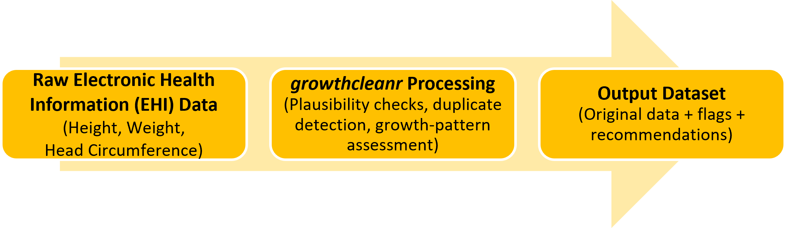

**Most users will complete four basic steps:**

- Prepare your data with the required variables.
- Run
  [`cleangrowth()`](https://growthcleanr.org/reference/cleangrowth.md)
  to evaluate measurements.
- Review the output and exclusion recommendations. Recommendations can
  be used directly from *growthcleanr* or customized by researchers.
- Create an analysis-ready dataset using observations classified as
  suitable for inclusion. Optional utility functions can reshape data
  and calculate BMI-related measures.

------------------------------------------------------------------------

### Required Input Variables

The following variables (columns) are required when running
*growthcleanr*. Default variable (column) names and default coding for
those variables are below. Alternate names and alternate coding schemes
may be used.

[TABLE]

  
Users are also strongly encouraged to include a unique row-level
identifier, which can be numeric or string. Providing a unique ID (`id`)
ensures handling of ties and duplicate measurements and improves
reproducibility across runs. When no valid ID is supplied,
*growthcleanr* generates an internal identifier and preserves the
original data unchanged in the output.

------------------------------------------------------------------------

### Supported Measurement Types

Metric measurements (kilograms, centimeters) are strongly preferred, but
*growthcleanr* can also accept imperial measurements (pounds, inches).

### What Does growthcleanr Return?

Unlike earlier versions that returned exclusion codes as a vector that
had to be recombined with a user’s dataset, the current version returns
a complete data table containing:

- Your original data
- Exclusion recommendations (column: `exclude`)
- Binary inclusion/exclusion classifications (column: `bin_exclude`)
- Unit-error-range indicators (column: `unit_error_range`)
- Optional diagnostic columns when requested

**Technical reference**: See [Output: the cleangrowth() return
value](https://growthcleanr.org/articles/output.html) for a complete
description of all output columns and optional diagnostics.

------------------------------------------------------------------------

## **Using the growthcleanr Shiny App**

The *growthcleanr* Shiny App provides a point-and-click interface. Users
can select data, configure cleaning options, run *growthcleanr*, and
review results without writing R code.

**Before You Begin**

Although the *growthcleanr* Shiny App does not require users to write R
code during data cleaning, it does run through R on your computer. This
is necessary to keep your data secure. As a result, a one-time setup is
required before you can launch the application.

There are three components involved:

- **R**: the software that runs the application.
- **Shiny**: the R package that allows the application to operate.
- ***growthcleanr*** **Shiny App**: the point-and-click interface used
  for data selection, cleaning, review, and export.

The Shiny App must be launched from R during each session of data
cleaning and/or analysis (described below). Once the Shiny App is
launched, the remaining steps can be completed through the
point-and-click interface. The Shiny App supports many data format
options, but some advanced options are only available in R.

**Important**: Users who prefer working in R should visit:
<https://growthcleanr.org/articles/how-to-r.html>.

------------------------------------------------------------------------

### Step 1: Install growthcleanr and Launch the Shiny App Using R

The *growthcleanr* and Shiny packages are both required to run the
*growthcleanr* Shiny App. The *growthcleanr* package will automatically
install the Shiny package, so installing the *growthcleanr* package will
allow you to run the Shiny App (described below).

Note: For first time use, users will need to run
`install.packages("growthcleanr")` followed by
[`library(growthcleanr)`](https://growthcleanr.org/) and
[`growthcleanr_app()`](https://growthcleanr.org/reference/growthcleanr_app.md).
Following the first time installation, most users will only need to run
[`library(growthcleanr)`](https://growthcleanr.org/) and
[`growthcleanr_app()`](https://growthcleanr.org/reference/growthcleanr_app.md).
Users working in virtual desktop environments (for example, Citrix) may
need to reinstall packages if their environment does not retain
installed software between sessions. These steps are described below.

------------------------------------------------------------------------

**Install R**

- Visit <https://cran.r-project.org/>
- Download R version appropriate for your operating system (Windows,
  Mac, or Linux).
- Follow the installation instructions provided by CRAN.
- Additional instructions on R installation can be found
  [here](https://cran.r-project.org/doc/manuals/r-release/R-admin.html)

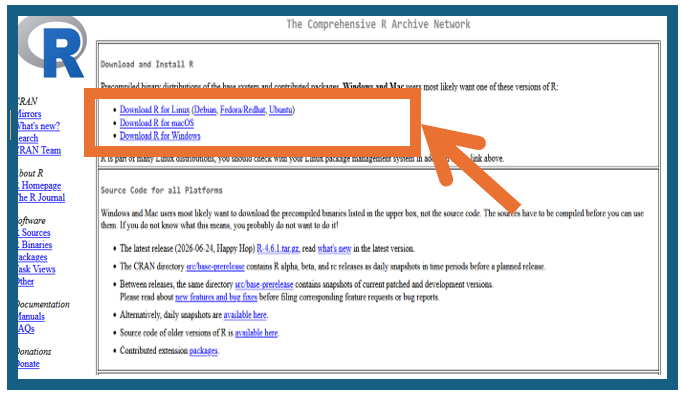

------------------------------------------------------------------------

**Open R**

- Open R from your computer’s Start Menu (Windows) or Applications
  folder (Mac).
- The R Console window will appear showing a prompt with an arrow and
  cursor. This indicates R is ready to accept commands.

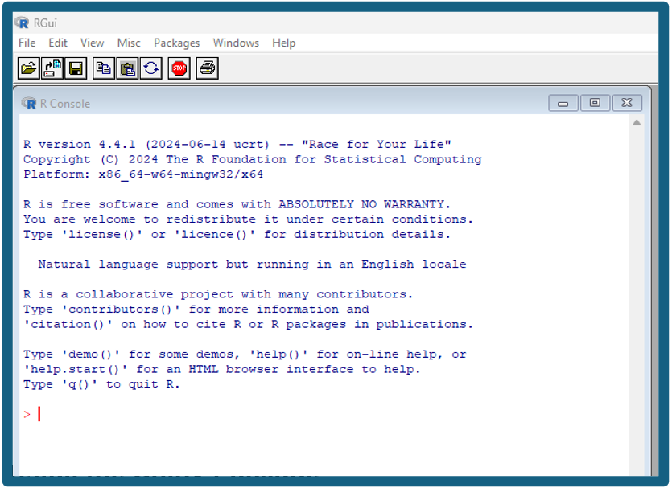

------------------------------------------------------------------------

**Install growthcleanr Package**

Once R is open, copy and paste the following command into the R Console
and press Enter.

**For users running R directly on their own computers, the installation
commands only need to be completed once.** However, users working in
virtual desktop environments (for example, Citrix or other cloud-based R
environments) may need to reinstall packages each time a new session is
started, depending on how that environment is configured.

``` r

install.packages("growthcleanr")
```

  
After you press Enter, R will display messages showing the progress of
the installation. If prompted to select a CRAN mirror, choose a location
near you. Depending on your internet connection and computer settings,
you may see information about downloading files, installing
dependencies, building packages, and testing the installation. This
output is expected and may take several minutes to complete.

When installation is finished, R will return to a command prompt (`>`).
You may also see a message “*The downloaded source packages are in…*”
followed by a file location on your computer. This message indicates
that the package was downloaded and installed successfully and is not an
error. Once the command prompt (`>`) reappears, you can proceed to the
next command. The screenshot below illustrates the installation for
`install.packages("growthcleanr")`.

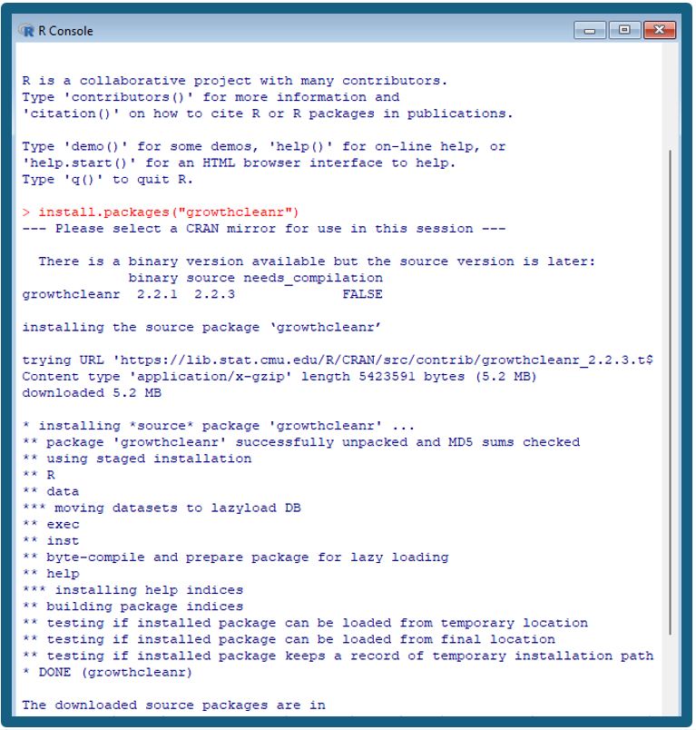

------------------------------------------------------------------------

**Launch the growthcleanr Shiny App**

After package installation is complete, or if you previously installed
*growthcleanr* on your computer using R, copy and paste the following
commands into the R Console one at a time, pressing Enter after each
command. The [`library()`](https://rdrr.io/r/base/library.html) command
loads the *growthcleanr* package into your current R session, and
[`growthcleanr_app()`](https://growthcleanr.org/reference/growthcleanr_app.md)
launches the Shiny App.

For future sessions, most users will only need to run these two commands
to launch the application. Users working in virtual desktop environments
(for example, Citrix) may need to reinstall packages if their
environment does not retain installed software between sessions.

``` r

library(growthcleanr)
growthcleanr_app() 
```

  
Once the application launches, it will open in a web browser window.
Although the application is displayed in a browser, it runs locally on
your computer through R rather than through a public website. All data
remain on your local machine. All remaining data selection, cleaning,
review, and export steps can be completed through the point-and-click
interface without writing R code.
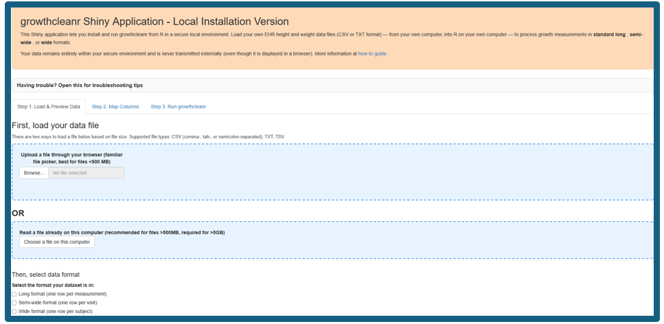

### Step 2: Select and Preview Data

Before selecting your data, **verify that your dataset is saved as a
comma-separated values (`.csv`), tab-delimited text (`.txt`), or
tab-separated values (`.tsv`) file.** The file should contain variables
corresponding to the required inputs for *growthcleanr*: a subject
identifier (`subjid`), measurement type (`param`), age in days
(`agedays`), sex (`sex`), and measurement value (`measurement`). See
[Required Input Variables](#required-input-variables) for detailed
descriptions of each variable. A unique row-level identifier (`id`) is
also strongly recommended. The default measurement types are WEIGHTKG,
HEIGHTCM, and HEADCM, although alternative measurement types and coding
schemes can be mapped during data import.

For instructions and a tutorial about making CSV files, see [How to get
your data into CSV format and back out
again](https://growthcleanr.org/articles/csv-format.html).

To begin, navigate to “*Step 1: Load & Preview Data*” and use the
“*Select the format your dataset is in*” option to choose the
appropriate format. Please note that steps in the Shiny App and steps in
this guide differ by 1 number (for example, “*Step 1: Load & Preview
Data*” is under Step 2: Select and Preview Data in this guide).

The *growthcleanr* Shiny App accepts data in long, semi-wide, and wide
formats. Descriptions for each format are listed below.

**Long format**: Each row contains a single measurement for a subject at
a specific age. This is the default format used by *growthcleanr*. For
example, a child with weight and height recorded at the same visit would
have two rows: one for weight and one for height.

Long format is recommended because it is the native format used
internally by *growthcleanr*, but all three formats are supported by the
Shiny App. The default measurement types are: WEIGHTKG, HEIGHTCM, and
HEADCM. Using metric units is strongly recommended. For information on
using imperial units, see [the wrapper/cleangrowth()
pipeline](https://growthcleanr.org/articles/wrapper.html).

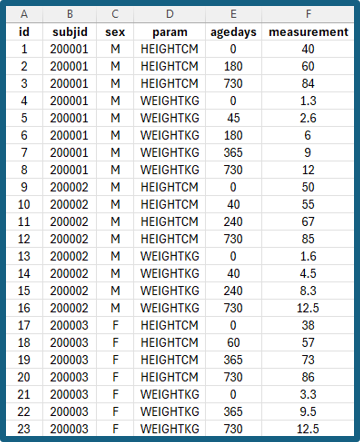

**Semi-wide format**: Each row represents a single subject visit or age,
with separate columns for different measurement types (for example,
weight and height). 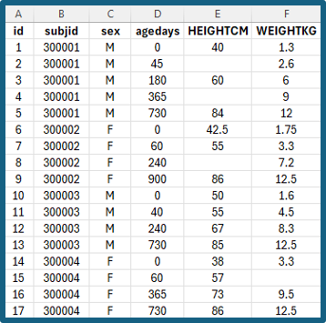

**Wide format**: Each subject appears on a single row, with measurements
across multiple ages or time points stored in separate columns.
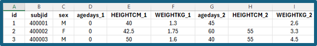

------------------------------------------------------------------------

**Load Your File**

**After selecting the data format, choose how you would like to load
your file**:

- **Upload a file through your web browser**: Recommended for most
  datasets and generally works best for files smaller than approximately
  500 MB.
- **Read a file already on this computer**: Recommended for larger
  datasets (greater than approximately 500 MB) and required for files
  larger than 5 GB.

After selecting a file-loading method, choose the appropriate input
format and load your dataset. The screenshots below illustrate two
scenarios:

- **Scenario \#1: Data with default variable names**: Dataset uses
  expected *growthcleanr* variable names (for example, `subjid`,
  `param`, `agedays`, `sex`, and `measurement`)

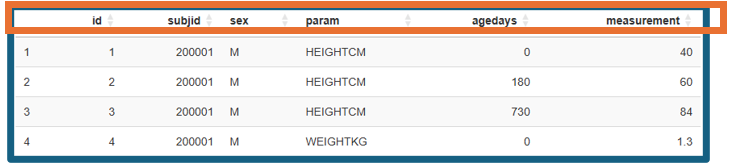

- **Scenario \#2: Data with custom variable names**: Dataset uses
  different column names and variables must be mapped to the appropriate
  *growthcleanr* inputs during selection.

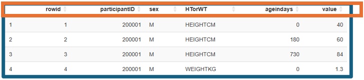

**After data selection, verify that**:

- **Variables were imported correctly.** Confirm that the expected
  columns appear in the data preview and that text, numeric, and date
  fields were interpreted correctly. For example, an incorrect data
  import may include birthdates as the age variables (below):

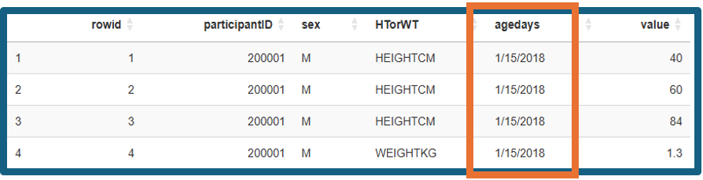

- **Confirm that values appear as expected.** For example, check several
  weight values to make sure they are in the range expected for weight
  in the chosen unit.
- **Row counts match the original dataset.** The number of records
  displayed in the app should match the number of records in the source
  file.
- **Missing values are handled appropriately.** Review the preview to
  identify unexpected blank values or columns that may not have imported
  correctly.
- **Subject identifiers and ages appear reasonable.** Verify that
  subject IDs uniquely identify individuals and that age values are
  reported in days.

Because *growthcleanr* evaluates measurements within an individual’s
longitudinal growth trajectory, accurate subject identifiers and age
values are particularly important.

------------------------------------------------------------------------

### Step 3: Map Columns and Validate Your Data

After your file has been selected, click on “*Step 2: Map Columns*” to
review the column mappings to ensure that *growthcleanr* correctly
identifies the required variables.

When mapping variables, verify the following:

- **Patient Subject ID (`subjid`)** column identifies each individual
  and is mapped to the correct identifier field.
- **Parameter (`param`)** column contains the measurement type values
  (for example, WEIGHTKG, HEIGHTCM, or HEADCM).
- **Measurement (`measurement`)** column contains the recorded
  measurement values (not rounded).
- **Age calculated as number of days since birth date (`agedays`)**
  column contains age at measurement expressed in days.
- **Sex (`sex`)** column contains the sex variable. By default,
  *growthcleanr* recognizes `0`, `M`, `Male`, `B`, or `Boy` as male and
  `1`, `F`, `Female`, `G`, or `Girl` as female (case-insensitive). The
  application will automatically identify common coding schemes and
  populate the sex-coding settings when recognized. Users will be
  prompted to confirm that the detected coding is correct. Please note
  that for *growthcleanr* users who also use the *cdcanthro* package,
  the use of `M`/`F` or `B`/`G` coding is recommended. The *cdcanthro*
  package uses codes `1` for male and `2` for female. To prevent coding
  conflicts, *growthcleanr* will return an error if it detects the use
  of `1`/`2` coding.  
- **Observation ID (`id`)** (optional) contains a unique row-level
  identifier, if available. Providing an Observation ID improves
  reproducibility and handling of duplicate measurements.
- **Parameter** value labels match the labels used in your dataset for
  weight, height, and head circumference measurements.
- **Units** (kg/lb and cm/in) accurately reflect the units used in the
  source data.
- **Optional date-of-birth and visit-date fields** may be supplied when
  available but are not required.
- **Keep only the columns** ***growthcleanr*** **needs** (optional) may
  be selected to retain only the variables required for processing and
  output. This option can reduce memory use and is recommended for large
  datasets.

As described above, the mapping process depends on whether your dataset
uses the default *growthcleanr* variable names (Scenario 1) or custom
variable names (Scenario 2).

- **Scenario 1: If your dataset uses the default variable names**
  ***(`subjid`, `param`, `agedays`, `sex`, `measurement`),*** **these
  fields may be populated automatically.**
  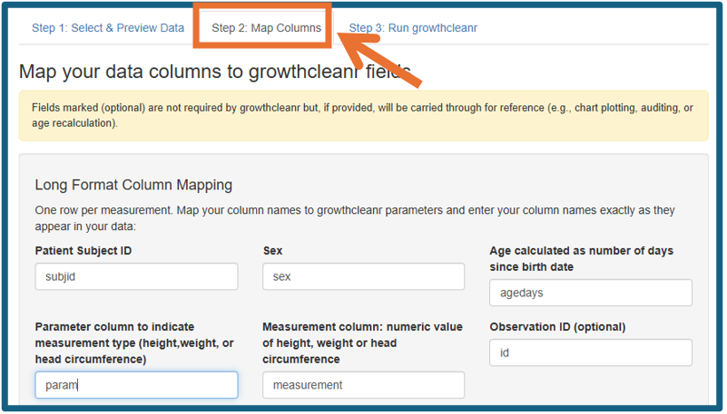

- **Scenario 2: If your dataset uses different variable names, select
  the appropriate column for each required input.**
  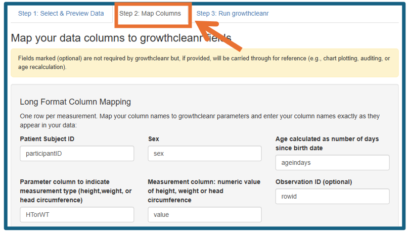

Once all mappings have been reviewed, click “Apply Mapping.” Confirm all
variables look correct in the “Mapped Data Preview.”
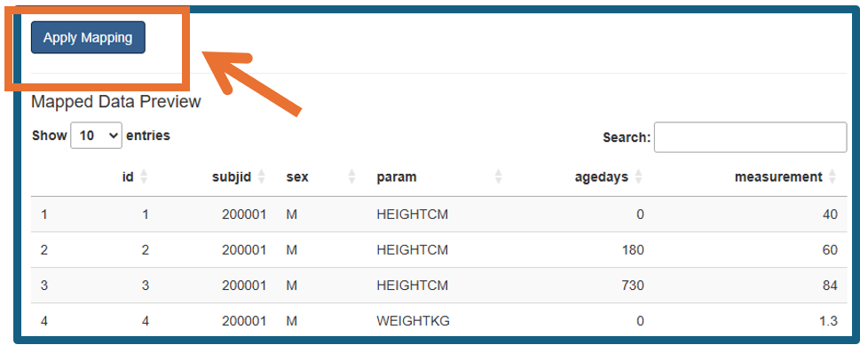

------------------------------------------------------------------------

### Step 4: Run growthcleanr

First, select Step 3: Run growthcleanr. Click “*Verify growthcleanr
version*” to confirm *growthcleanr* has loaded successfully.

Then, optionally, click “*Run quick test*” to perform a diagnostic check
on a random sample of up to 100 patients before processing the full
dataset. This step allows you to identify potential data formatting,
mapping, or configuration issues and confirm that the workflow is
functioning as expected before running the complete cleaning process.

Finally, once the quick test has completed (or if you choose to skip
it), click “*Clean my data*” to process the selected dataset.

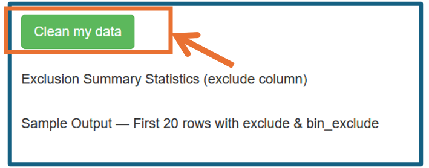

During processing, *growthcleanr*: - Evaluates pediatric and adult
records using age-appropriate algorithms. - Identifies implausible
values. - Identifies carried-forward measurements. - Chooses a single
value for evaluation if multiple values are present for the same
subject, age, and growth parameter. - Produces user-friendly output
classifications.

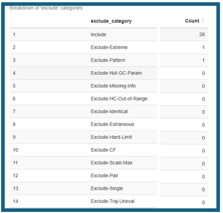

**Technical reference**: See [Technical reference: the cleangrowth()
pipeline](https://growthcleanr.org/articles/wrapper.html) for a
description of preprocessing, batching, adult/child routing, and output
assembly. Details of the individual algorithms are available here:
[Technical reference: child
algorithm](https://growthcleanr.org/articles/child-algorithm.html) and
[Technical reference: adult
algorithm](https://growthcleanr.org/articles/adult-algorithm.html).

------------------------------------------------------------------------

### Step 5: Review Results

After processing is complete, *growthcleanr* displays a summary of the
cleaning results within the application. The results view includes:

- An **exclusion summary** showing the number of measurements assigned
  to each inclusion or exclusion category.
- A summary line indicating **how many measurements were included**,
  displayed as “**X of Y measurements included**.”
- A **preview of the first 20 rows** of the cleaned output dataset,
  allowing users to review results before downloading.

The returned dataset contains your original data plus cleaning results.
*growthcleanr* does not remove observations. Instead, it provides a
recommendation to include or exclude each measurement including a broad
reason for exclusion. Key output columns include:

| Column | Purpose |
|----|----|
| `exclude` | Summary exclusion recommendation indicating a broad reason for exclusion |
| `bin_exclude` | Binary inclusion/exclusion classification |
| `unit_error_range` | Indicator of possible unit conversion error |

  

- **`exclude`** column. The `exclude` column contains the primary
  cleaning result and is intended for routine use by most researchers.
  It returns “Include” for values that it recommends retaining for
  analysis and “Exclude-\[Reason\]” for values that it recommends
  excluding.

  - **Technical reference**: See [Exclusion
    codes](https://growthcleanr.org/articles/exclusion-codes.html) for
    the complete catalog of summary and detailed exclusion
    classifications.  
      

- **`bin_exclude`** column. Similar to the `exclude` column, but returns
  “Include” and “Exclude” without adding the reason for exclusion,
  allowing for simple filtering of values.

- **`unit_error_range`** column: The `unit_error_range` field is
  informational and identifies a value that could represent unit error
  in a child with typical growth. It is calculated separately from
  exclusions. Children with atypical growth may have true measurements
  in this range, so being in unit error range does not automatically
  trigger an exclusion. However, if unit errors are universal or nearly
  universal (such as with data processing or metadata errors), the
  longitudinal *growthcleanr* algorithm may not recommend exclusion of
  these values if they represent atypical but internally consistent
  growth. If a large proportion of values in a dataset are flagged with
  `unit_error_range = TRUE`, human assessment of the data is needed.

  - **Technical reference**: See [Output: the cleangrowth() return
    value](https://growthcleanr.org/articles/output.html) and [Technical
    reference: algorithm
    functions](https://growthcleanr.org/articles/algorithm-functions.html)
    for details on the `unit_error_range` flag and how it is
    generated.  
      

- *Note on head circumference results*. Head circumference measurements
  are supported through age five years.

  - **Technical reference**: See [Technical reference: child
    algorithm](https://growthcleanr.org/articles/child-algorithm.html)
    for a detailed discussion of head circumference processing and age
    restrictions.

------------------------------------------------------------------------

### Step 6: Create an Analysis-Ready Dataset

After reviewing the cleaning results within the application, click
“*Save results (CSV)*” to save the cleaned dataset. The exported file
contains both the original data and all *growthcleanr* output variables,
including inclusion and exclusion recommendations.

A common workflow is to retain measurements classified as “Include.”
Researchers can create an analysis-ready dataset using observations
where the `exclude` variable is equal to “Include”, while retaining the
full output dataset for quality-control review, documentation, and
reproducibility. Researchers should review exclusion patterns and assess
whether additional investigation is warranted before proceeding with
analysis.
