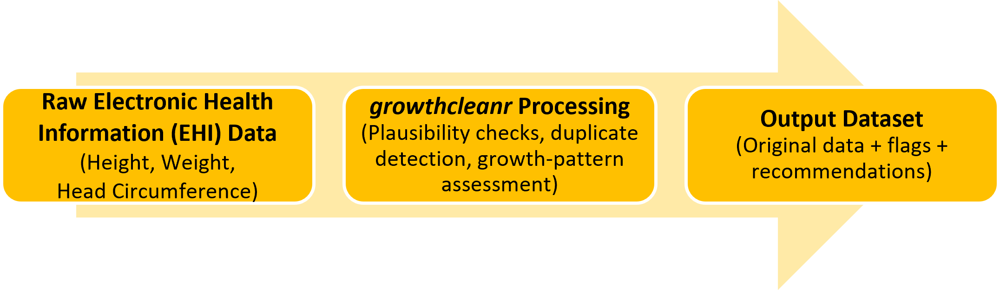
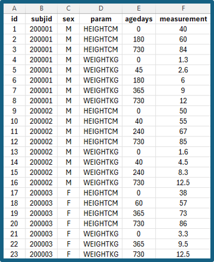
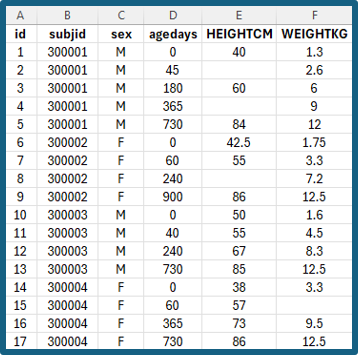
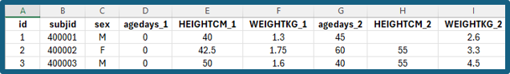
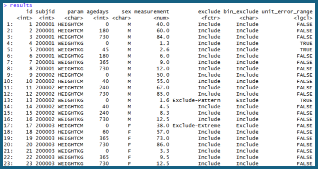
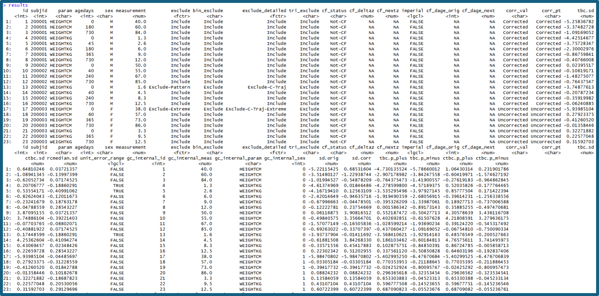
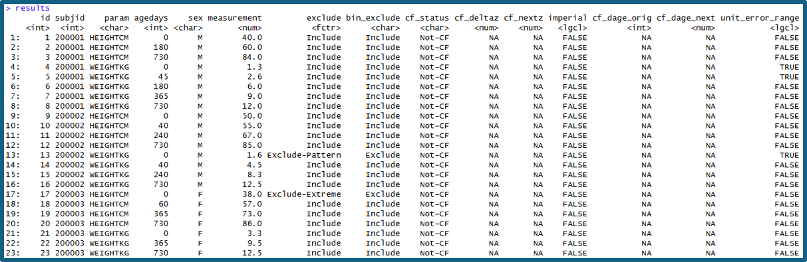

# **Introduction**

Height, weight, and head circumference measurements collected in electronic health records (EHRs) are essential for patient-centered outcomes research (PCOR), comparative effectiveness research (CER), and studies of growth, obesity, chronic disease risk, and other health outcomes. However, these data often contain errors such as data-entry mistakes, incorrect units, duplicate measurements, or other implausible values that can distort analyses and lead to incorrect conclusions.

***growthcleanr*** is an open-source R package designed to address these challenges. It provides automated methods for evaluating longitudinal anthropometric data and flagging measurements that may be erroneous or otherwise unsuitable for analysis. *growthcleanr* supports pediatric and adult data and evaluates weight, height/length, and head circumference measurements using age-appropriate cleaning algorithms. Unlike approaches that rely solely on cross-sectional thresholds, *growthcleanr* evaluates measurements within the context of an individual's longitudinal growth trajectory, allowing it to identify implausible patterns and inconsistencies that may not be apparent when measurements are reviewed in isolation. *growthcleanr* was originally developed using real-world EHR data and has been validated on both real-world and synthetic datasets. By improving the quality of anthropometric data, *growthcleanr* helps researchers and healthcare organizations generate more reliable data for secondary analyses, better understand growth and chronic disease risk, and support informed clinical and population health decisions.

*growthcleanr* has been updated to improve cleaning performance, efficiency, and usability. 

- Updates related to cleaning performance include improved handling of infant data, including for premature infants in outpatient settings; support for cleaning of head circumference data; improved handling of consecutive identical measurements (carried forwards) and consecutive erroneous values; and prespecified configurations for allowing more or less restrictive cleaning of adult data. 
- Efficiency updates include a checkpointing system that reduces memory use and improved support for parallel processing. 
- Usability updates include development of a Shiny app (described further below); simplified data entry; support for datasets in multiple formats; exclusion codes that are easier to understand and more relevant to researchers; a test data feature; more informative error messages; and a new output structure that returns the original data alongside cleaning results.

**Version 3 of** ***growthcleanr*** **(released in November 2026) includes a redesigned wrapper function,** `cleangrowth()`, which serves as the primary entry point for data cleaning. The wrapper handles many preprocessing and postprocessing tasks automatically, including validating inputs, standardizing supported measurement types, routing records to the appropriate pediatric or adult algorithm, assembling outputs, and returning results in a user-friendly format. 

**Technical reference**: See [Start here: Experienced users](https://growthcleanr.org/articles/experienced-start-here.html) for an overview of major changes introduced in version 3.

**For users who prefer not to work directly in R, the** ***growthcleanr*** **Shiny Application ("Shiny App") provides a point-and-click interface** for preparing and cleaning data, without the need for coding syntax. The Shiny App provides a graphical interface to the underlying *growthcleanr* workflow. Rather than requiring users to write R code, the application guides users through data selection, cleaning, review of exclusion recommendations, and export of results. This makes *growthcleanr* accessible to researchers, clinicians, quality-improvement teams, and other users with varying levels of programming experience. 

**At its core,** ***growthcleanr*** **helps users:**

- Identify potentially erroneous measurements
- Flag and categorize data quality issues
- Review exclusion recommendations
- Evaluate unit-conversion concerns and carried-forward values
- Efficiently and reproducibly prepare cleaned datasets for downstream analyses

---

# **Simple Workflow Overview**

## Workflow Steps

```{r echo=FALSE, out.width="70%", fig.align="center"}

```

**Most users will complete four basic steps:**

- Prepare your data with the required variables. 
- Run `cleangrowth()` to evaluate measurements. 
- Review the output and exclusion recommendations. Recommendations can be used directly from *growthcleanr* or customized by researchers.
- Create an analysis-ready dataset using observations classified as suitable for inclusion. Optional utility functions can reshape data and calculate BMI-related measures.

---
  
## Required Input Variables

The following variables (columns) are required when running *growthcleanr*. Default variable (column) names and default coding for those variables are below. Alternate names and alternate coding schemes may be used.
  
<style>
  .gc-table { border-collapse: collapse; width: 60%; }
  .gc-table th, .gc-table td { border: 1px solid #ddd; padding: 8px 12px; vertical-align: top; }
  .gc-table thead th { background-color: #185394; color: white; text-align: left; }
  .gc-table td, .gc-table th { text-align: left; }
</style>

<table class="gc-table" aria-label="Required Input Variables">
  <thead>
    <tr><th>Variable</th><th>Description</th></tr>
  </thead>
  <tbody>
    <tr><td>`subjid`</td><td>Unique subject identifier (numeric or string)</td></tr>
    <tr><td>`param`</td><td>Measurement type (defaults WEIGHTKG, HEIGHTCM, HEADCM)</td></tr>
    <tr><td>`agedays`</td><td>Age in days at measurement (numeric)</td></tr>
    <tr><td>`sex`</td><td>Sex, code as M (male) or F (female).<br>Sex may be blank or NA for the adult algorithm (by default switches to adult at 20y, can adjust to 18y).</td></tr>
    <tr><td>`measurement`</td><td>Recorded measurement value (not rounded)</td></tr>
  </tbody>
</table>
<br>
Users are also strongly encouraged to include a unique row-level identifier, which can be numeric or string. Providing a unique ID (`id`) ensures handling of ties and duplicate measurements and improves reproducibility across runs. When no valid ID is supplied, *growthcleanr* generates an internal identifier and preserves the original data unchanged in the output.

---
  
## Supported Measurement Types
  
Metric measurements (kilograms, centimeters) are strongly preferred, but *growthcleanr* can also accept imperial measurements (pounds, inches).
  
## What Does growthcleanr Return?

Unlike earlier versions that returned exclusion codes as a vector that had to be recombined with a user’s dataset, the current version returns a complete data table containing:

- Your original data
- Exclusion recommendations (column: `exclude`)
- Binary inclusion/exclusion classifications (column: `bin_exclude`)
- Unit-error-range indicators (column: `unit_error_range`)
- Optional diagnostic columns when requested 

**Technical reference**: See [Output: the cleangrowth() return value](https://growthcleanr.org/articles/output.html) for a complete description of all output columns and optional diagnostics.

---

# **Using growthcleanr with R Interface**

The R interface provides direct access to all *growthcleanr* functionality and is recommended for users who prefer using coding syntax or would like to use advanced configuration options. 

---

## Step 1: Install and Launch the growthcleanr Package Using R

---

**Install and Load growthcleanr**

The easiest way to install *growthcleanr* v3.0.0 is from CRAN. Most users should use the CRAN installation:

```r
install.packages("growthcleanr")
library(growthcleanr)
```

If you would like to install the developmental version directly from GitHub or build the package vignettes locally, use the code below. Building the vignettes installs the complete package documentation locally, allowing you to access technical references, examples, and tutorials directly from R.

```r
install.packages("remotes")
remotes::install_github(
"growth-data-tools/growthcleanr",
build_vignettes = TRUE,
dependencies = TRUE)
library(growthcleanr)
```

---

## Step 2: Prepare Your Data

Verify that your dataset contains variables corresponding to the required inputs for *growthcleanr*. These variables include a subject identifier (`subjid`), measurement type (`param`), age in days (`agedays`), sex (`sex`), and measurement value (`measurement`). See [Required Input Variables] for detailed descriptions of each variable. A unique row-level identifier (`id`) is also strongly recommended. 

For examples in this guide (which include synthetic data), the dataset has been loaded into R and is stored in an object named **`mydata`**. For instructions on importing and loading data, see R guidance on [R Data Import/Export](https://cran.r-project.org/doc/manuals/r-release/R-data.html) and [a tutorial about making CSV files](https://growthcleanr.org/articles/csv-format.html). A quick inspection of the first few rows (with data named `mydata`) can help verify that the data were imported correctly using:

```r
head(mydata)
```  
The default *growthcleanr* format is long format, in which each row contains a single measurement for a subject at a specific age. However, *growthcleanr* can also accommodate semi-wide and wide data structures using the appropriate utility functions and import options.

**Long format**: Each row contains a single measurement for a subject at a specific age. This is the default format used by *growthcleanr*. For example, a child with weight and height recorded at the same visit would have two rows: one for weight and one for height. 

Long format is recommended because it is the native format used internally by *growthcleanr*, but all three formats are supported by the Shiny App. The default measurement types are: WEIGHTKG, HEIGHTCM, and HEADCM. Using metric units is strongly recommended. For information on using imperial units, see [the wrapper/cleangrowth() pipeline](https://growthcleanr.org/articles/wrapper.html). 

```{r echo=FALSE, out.width="45%", fig.align="center"}

```

**Semi-wide format**: Each row represents a single subject visit or age, with separate columns for different measurement types (for example, weight and height).
```{r echo=FALSE, out.width="45%", fig.align="center"}

```

**Wide format**: Each subject appears on a single row, with measurements across multiple ages or time points stored in separate columns.
```{r echo=FALSE, out.width="70%", fig.align="center"}

```

---

**Optional**: Test Your Data with `gc_runtrial()`

Before running *growthcleanr* on your full dataset, it is recommended that you test your data using the `gc_runtrial()` function. This function runs *growthcleanr* on a small subset of records, allowing you to identify potential issues before processing the entire dataset.

The trial run can help verify that variable mappings, measurement types, and dataset formatting have been specified correctly and the data can be processed successfully by *growthcleanr*.

```r
gc_runtrial(mydata)
```
---

## Step 3: Run growthcleanr

For most users, cleaning can be performed using a single command:

```r
results <- cleangrowth(mydata)
```

For large datasets, *growthcleanr* includes checkpointing options that can reduce memory usage, improve performance, and allow interrupted runs to resume without restarting the entire cleaning process. See [Step 8: Process Large Datasets] for additional details about checkpointing. 

After running, *growthcleanr* provides information about rows that were not cleaned, such as those with negative `agedays` or a parameter that does not match *growthcleanr* columns (e.g., gestational age). It is common to have some uncleaned rows, but review the message to ensure the number and type of uncleaned rows is expected.

If your dataset uses different column names, *growthcleanr* allows you to map those names directly within the function call:

```r
results <- cleangrowth(mydata,
subjid = "patient_id",
param = "measure_type",
agedays = "age_days",
sex = "gender",
measurement = "value")
```

Users working with large datasets that require custom variable mappings can also use the checkpointing workflow described in [Step 8: Process Large Datasets].

Note: The data-frame interface is now the recommended way to use *growthcleanr* and replaces the older workflow of passing separate vectors.

**Technical reference**: See [Technical reference: the cleangrowth() pipeline](https://growthcleanr.org/articles/wrapper.html) for a complete description of data processing, validation, unit conversion, and algorithm dispatch.

---

## Step 4: Review the Output

A major change in the current version is that `cleangrowth()` returns a complete data table containing your original data and cleaning results, rather than a vector of exclusion codes that must be merged back into the source dataset.

```r
head(results)
```
The returned dataset preserves the original variables and adds one or more columns containing *growthcleanr* recommendations and diagnostic information. In the example output shown below, the original variables (`id`, `subjid`, `param`, `agedays`, `sex`, and `measurement`) are retained alongside new cleaning-related variables.

**Key output columns include:**

- **`exclude`**: The primary exclusion recommendation returned by *growthcleanr*. Most records will be classified as "Include". Observations for which exclusion is recommended will receive an exclusion classification indicating the reason for exclusion (for example, "Exclude-Pattern" or "Exclude-Extreme").
- **`bin_exclude`**: A simplified binary classification containing only "Include" or "Exclude" values. This variable is useful when creating analysis-ready datasets.
- **`unit_error_range`**: An informational flag indicating that a value falls within a range commonly associated with unit-conversion errors (for example, pounds recorded as kilograms or inches recorded as centimeters). This flag does not automatically exclude a measurement.

The example output below illustrates several common scenarios. Most observations are retained with `exclude = "Include"` and `bin_exclude = "Include"`. However, a small number of observations have been classified as "Exclude-Pattern" or "Exclude-Extreme", demonstrating how *growthcleanr* identifies measurements that may be inconsistent with an individual's longitudinal growth trajectory or biologically implausible values.

**Researchers should review exclusion patterns before analysis and determine whether the default** ***growthcleanr*** **recommendations are appropriate for their specific research question.**

```{r echo=FALSE, out.width="70%", fig.align="center"}

```

**Technical reference**: See [Output: the cleangrowth() return value](https://growthcleanr.org/articles/output.html) for the complete output contract, definitions of all columns, and available optional outputs. 

---

## Step 5: Interpret Cleaning Results

The primary result returned by *growthcleanr* is the `exclude` column. This summary classification is intended for routine use and provides the recommended disposition of each measurement. Most users can base their inclusion and exclusion decisions directly on this variable.

Measurements classified as "Include" are recommended for retention in analyses. Measurements classified as "Exclude-[Reason]" have been identified as potentially problematic based on the *growthcleanr* cleaning algorithms. The text following "Exclude-" provides a broad reason for the recommendation (for example, "Exclude-Pattern" or "Exclude-Extreme").

Users who would like more detailed information about why a measurement was excluded can request detailed exclusion codes:

```r
results <- cleangrowth(data = mydata, exclude_detail = TRUE)
```

This adds an `exclude_detailed` column containing more granular information about the cleaning process and the algorithm step associated with each exclusion classification. 

The `unit_error_range` column should be interpreted as an informational flag. Values marked as `TRUE` are in a range commonly associated with unit-conversion errors, but the flag does not automatically indicate an error and does not affect the exclusion recommendation. This flag highlights measurements whose value is consistent with common unit-conversion errors (for example, pounds recorded as kilograms or inches recorded as centimeters). Because *growthcleanr* evaluates measurements longitudinally, true measurements may also fall within these ranges, so the flag is intended to support further review when there is a high prevalence of measurements in unit error range, and does not result in automatic exclusion.

**Technical reference**: See [Exclusion codes](https://growthcleanr.org/articles/exclusion-codes.html) for the full list of summary and detailed exclusion classifications and their mappings.

---

## Step 6: Explore Additional Diagnostic Information

For most projects, the standard output is sufficient. However, *growthcleanr* can return additional diagnostic information that may be useful when validating results or investigating unusual records. The simplest way to request all available diagnostics is:

```r
results <- cleangrowth(data = mydata,full_detail = TRUE)
```

This option adds detailed exclusion information, carried-forward diagnostics, correction indicators, recentering outputs, internal identifiers, and additional troubleshooting information. 

**Technical reference**: See [Output: the cleangrowth() return value](https://growthcleanr.org/articles/output.html) and [Configuration: arguments and thresholds](https://growthcleanr.org/articles/configuration.html) for descriptions of every diagnostic column returned.

```{r echo=FALSE, out.width="100%", fig.align="center"}

```

Users specifically interested in repeated measurements and carried-forward values can request carried-forward diagnostics alone:

```r
results <- cleangrowth(data = mydata,cf_detail = TRUE)
```
```{r echo=FALSE, out.width="100%", fig.align="center"}

```

**Technical reference**: See [Carried-forward value rescue](https://growthcleanr.org/articles/cf-rescue.html) for interpretation of `cf_status`, `cf_deltaz`, `cf_nextz`, and related diagnostic outputs.

**Technical reference**: See [Technical reference: algorithm functions](https://growthcleanr.org/articles/algorithm-functions.html) and [Deriving the recentering reference medians](https://growthcleanr.org/articles/recentering.html) for additional information about recentered z-scores and reference values

These options are particularly useful when evaluating unexpected exclusions or conducting methodological work. 

---

## Step 7: Create an Analysis-Ready Dataset

*growthcleanr* never removes observations from the returned dataset. Instead, it provides recommendations that allow researchers to determine which measurements should be included in downstream analyses. A common workflow is to retain measurements classified as "Include":

```r
analysis_data <- subset(results,exclude == "Include")
```

**Researchers should review exclusion patterns and assess whether additional investigation is warranted before proceeding with analysis.**

---

## Step 8: Process Large Datasets

For large datasets, *growthcleanr* includes checkpointing functionality that saves intermediate results. It substantially reduces memory usage and can allow interrupted runs to resume without restarting the entire cleaning process. Checkpointing is on by default: for datasets with more than 5,000 subjects, `cleangrowth()` saves checkpoints to a temporary folder and deletes them when the run finishes. If you are concerned about a run getting interrupted, you can save the checkpoints to a folder you choose so that the run can resume, using the code below. Note: *growthcleanr* creates the checkpoint directory if it does not exist.

```r
results <- cleangrowth(data = large_data, checkpoint_dir = "checkpoint_output")
```

If a run is interrupted, run the same command again with `checkpoint_resume = TRUE`, using the same folder and the same data. Checkpoints that already finished are skipped.

```r
results <- cleangrowth(data = large_data, checkpoint_dir = "checkpoint_output", checkpoint_resume = TRUE)
```

To recombine saved checkpoints later (for example, to reload results without re-running the cleaning), use:

```r
results <- cleangrowth_checkpoint_combine(checkpoint_dir = "checkpoint_output")
```

**Technical reference**: See [Technical reference: the cleangrowth() pipeline](https://growthcleanr.org/articles/wrapper.html) and [Configuration: arguments and thresholds](https://growthcleanr.org/articles/configuration.html) for details on batching, checkpointing, and performance options.

---

## Step 9: Use Utility Functions for Additional Analyses

After cleaning, *growthcleanr* provides utility functions that support common analytic workflows. These include functions for reshaping data, preparing semi-wide datasets, calculating BMI, and computing extended BMI z-scores. Such tools can simplify the transition from data cleaning to statistical analysis and quality-measure reporting.

**Technical reference**: See [Utility functions](https://growthcleanr.org/articles/utilities.html) for additional information about `longwide()`, BMI calculations, and extended BMI z-score workflows.

---

# **Additional Technical References**

The following technical references (included in this guide) provide detailed documentation:

- [Start here: Experienced users](https://growthcleanr.org/articles/experienced-start-here.html)
- [Technical reference: the cleangrowth() pipeline](https://growthcleanr.org/articles/wrapper.html)
- [Technical reference: child algorithm](https://growthcleanr.org/articles/child-algorithm.html)
- [Technical reference: adult algorithm](https://growthcleanr.org/articles/adult-algorithm.html)
- [Exclusion codes](https://growthcleanr.org/articles/exclusion-codes.html)
- [Output: the cleangrowth() return value](https://growthcleanr.org/articles/output.html)
- [Carried-forward value rescue](https://growthcleanr.org/articles/cf-rescue.html)
- [Technical reference: algorithm functions](https://growthcleanr.org/articles/algorithm-functions.html)
- [Deriving the recentering reference medians](https://growthcleanr.org/articles/recentering.html)
- [Configuration: arguments and thresholds](https://growthcleanr.org/articles/configuration.html)
- [Technical reference: testing](https://growthcleanr.org/articles/testing.html)

For further information, please visit [www.growthcleanr.org](https://growthcleanr.org/)

**This work was funded by the Office of the Secretary Patient-Centered Outcomes Research Trust Fund (OS-PCORTF).**

For more information about the OS-PCORTF projects described in this resource, please reach out to [OSPCORTF@hhs.gov](mailto:OSPCORTF@hhs.gov) 

Explore the OS-PCORTF project portfolio at https://aspe.hhs.gov/collaborations-committees-advisory-groups/os-pcortf/explore-portfolio


